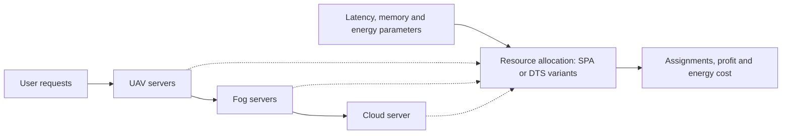
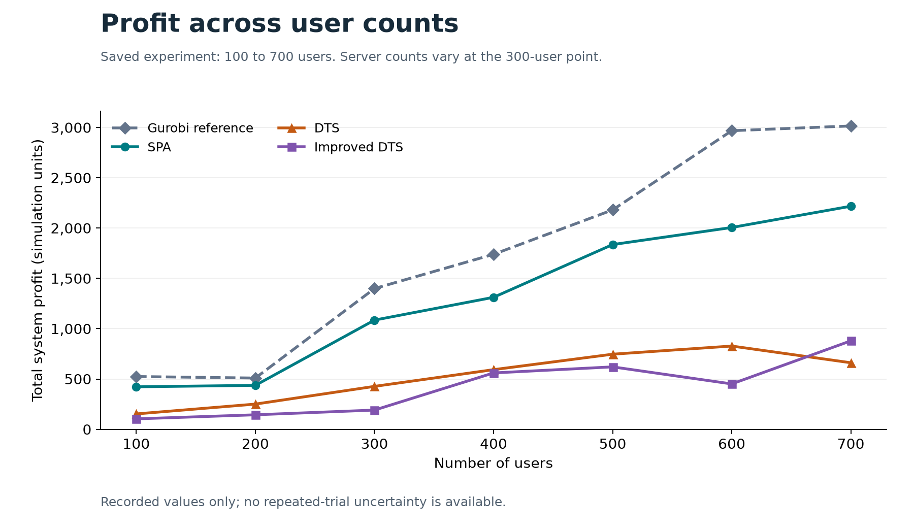
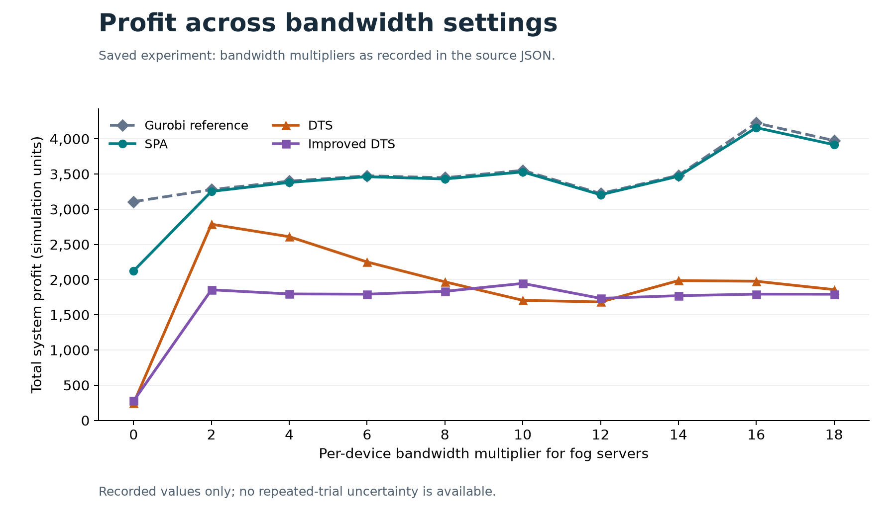

**Project completed at CSIR CEERI in Dec 2022. Publishing on Github for personal record.**

# UAV-Assisted Edge Computing: Resource Allocation and Simulation

This project studies how user requests can be served across UAVs, fog servers, and a cloud server while accounting for latency, memory capacity, and energy cost. It combines a UAV movement simulator, resource allocation algorithms, a deep Q-network implementation, and scripts for comparing system profit under different operating conditions.

The main question is where to place a request and how much traditional memory or non-volatile memory (NVM) to allocate to it. Moving a workload closer to the user can reduce transmission delay, but edge devices have limited resources. The experiments examine that trade-off as user count, bandwidth, server count, memory configuration, and energy pricing change.

## Project overview

The simulation uses three computing tiers:

| Component | Role |
| --- | --- |
| User equipment (UE) | Generates requests with resource and delay requirements |
| UAV servers | Provide coverage and serve requests at the aerial edge |
| Fog servers (FS) | Provide an additional computing tier between UAVs and the cloud |
| Cloud server | Provides a remote execution option when its latency is acceptable |

Requests are evaluated against the available servers and memory configurations. Feasible assignments must satisfy memory and delay constraints. The allocation routines then produce user-to-server mappings and their associated profit.

A typical run loads or generates a scenario, moves the UAVs, identifies covered users, evaluates resource allocation, and saves the resulting assignments and plots.



Solid arrows across the top show the communication tiers. Dotted links connect the computing tiers to the allocation step, which decides where requests are served.

## Implemented methods

| Method | Implementation |
| --- | --- |
| SPA | Builds user and server preferences, performs matching, and attempts to place remaining users |
| DTS | Baseline allocation routine in `spa_module/dts_algo_scripts/dts_algorithm_caller.py` |
| Improved DTS | Alternative allocation routine; the environment currently calls `temp_improved_dts.py` |
| Gurobi reference | Solves the allocation formulation for a saved local scenario in `testing_gurobi.py` |
| Deep Q-network | Separate Q-network and target network per UAV, with replay memory and epsilon-greedy action selection |

The movement policy first checks the action returned by `utils.cz3a`. It falls back to the Q-network policy when that helper returns no action. This behavior matters when interpreting a run as a learned policy.

## Recorded metrics

The table below reports total system profit from the saved [user-count experiment](comparative_plots/ue_count_variation_plot_folder/accumulated_data.json). Values are rounded to two decimal places and use the simulation's profit scale; no currency is specified in the result file.

| Users | SPA | DTS | Improved DTS | Gurobi reference (`optimal`) |
| ---: | ---: | ---: | ---: | ---: |
| 100 | 422.41 | 152.94 | 103.72 | 524.49 |
| 200 | 436.83 | 250.61 | 144.19 | 509.46 |
| 300 | 1,085.11 | 426.66 | 191.09 | 1,398.80 |
| 400 | 1,311.91 | 592.88 | 560.30 | 1,739.14 |
| 500 | 1,836.24 | 746.39 | 620.54 | 2,180.83 |
| 600 | 2,005.90 | 827.54 | 450.98 | 2,967.80 |
| 700 | 2,217.51 | 661.39 | 879.24 | 3,015.11 |

At 700 users, recorded SPA profit is **235.28% higher than DTS** and **73.55% of the Gurobi reference**. These are calculated as `(SPA / DTS - 1) × 100` and `(SPA / reference) × 100`, respectively. SPA exceeds both DTS variants at all seven saved user counts.

These figures describe the stored experiment, not averages across repeated trials. The JSON does not provide seeds, confidence intervals, or solver gaps. The current user-count script also assigns two fog servers at 300 users and one at the other counts, so it should not be treated as a strictly fixed-infrastructure comparison. The Gurobi result is a reference for the local allocation problem, not a guarantee of globally optimal UAV placement.

## Results at a glance



SPA records higher profit than both DTS variants at every saved user count. The Gurobi reference remains above SPA. This is the same data as the metrics table, including the server-count caveat at 300 users.



In the saved bandwidth sweep, SPA stays close to the Gurobi reference at the nonzero multipliers. The values come from the [bandwidth results](comparative_plots/bandwidth_comparison_plot_folder/accumulated_data.json); they belong to a separate experiment from the user-count comparison.

Both charts are drawn directly from the saved JSON files. To regenerate them without running the simulation:

```bash
python docs/plot_readme_results.py
```

Other recorded outputs include:

| Metric or experiment | Location |
| --- | --- |
| Profit versus fog-server bandwidth | `comparative_plots/bandwidth_comparison_plot_folder/` |
| Profit versus energy cost coefficient (`phi`) | `comparative_plots/phi_comparison_plot_folder/` |
| Revenue, energy cost, and profit versus `phi` | `comparative_plots/revenue_energy_cost_phi_comparison_plot_folder/` |
| Profit versus server count | `comparative_plots/profit_server_count_comparison_plot_folder/` |
| Profit versus NVM-to-traditional-memory latency ratio | `comparative_plots/nvm_by_trad_latency_comparison_plot_folder/` |
| Memory allocation fractions | `comparative_plots/memory_config_fraction/` |

Revenue and energy cost are separate recorded measures. Some rows in the saved revenue/energy sweep do not reconcile with the recorded profit by simple subtraction, so those values need checking before reuse in further analysis.

## Configuration

The checked-in [environment parameters](environment_class/environment_parameters.json) specify:

| Parameter | Value |
| --- | ---: |
| UAVs | 2 |
| Fog servers | 1 |
| Users | 700 |
| User cluster centers | 2 |
| Simulation boundaries | 250 × 250 |
| UAV altitude parameter (`Z`) | 20 |
| Maximum steps per episode | 50 |
| Discrete actions per UAV | 9 |
| Coverage overlap penalty | 30 |
| Collision penalty | 100 |

Server resources and user workloads are stored in `dataset/system_data.json` and `dataset/global_user_data.json`. Scenario-generation inputs live in `spa_module/data_dict.json`, with alternative configurations in `data_dict_files/`.

The DQN code defines four hidden layers of 64 units with ReLU activations. Its configured optimizer is AdamW, with a learning rate of `0.001`, batch size of `32`, discount factor of `0.99`, and exploration probability of `0.2`. Target networks are scheduled to update every 10 episodes. The entry point requests `UAV_count × 200 + 5` episodes, which is 405 for the default configuration.

**Current training status:** `training_scripts/training.py` uses `range(1, 1)`, so the optimization loop performs no training episodes. In addition, `training_scripts/stat_module.py` constructs interpolated values with added noise instead of storing the reward passed to `append`. Training plots from this helper should not be used as evidence of DQN convergence. Enabling the loop alone is not enough to establish a validated training run.

## Running the project

Run commands from the project root. The scripts resolve data and output paths from the current working directory.

There is no pinned dependency file. The following installs the packages imported by the main simulation and analysis scripts; it is a starting environment, not a verified reproduction of the original 2023 setup.

```bash
python3 -m venv .venv
source .venv/bin/activate
python -m pip install torch numpy matplotlib gymnasium tqdm scipy pandas
```

For the optimization reference and sweeps that call it, install `gurobipy` and configure a suitable Gurobi license:

```bash
python -m pip install gurobipy
```

Run the default SPA simulation using the saved scenario:

```bash
python main_file.py
```

Select another allocation method through the Python entry point:

```python
from main_file import main

main(algo_type="dts", copy_env_from_file=True)
# Other supported values: "spa", "improved_dts"
```

Set `copy_env_from_file=False` to generate and save a new scenario. Runs write to `dataset/local_dataset/`, `environment_class/*carrier.json`, `results_and_logs/`, and `plots/`. Experiment scripts can also overwrite configuration and accumulated result files, so keep a copy of any results you want to retain before rerunning them.

To redraw the bandwidth comparison from the saved data:

```bash
python comparison_plot_script.py
```

This script currently selects the bandwidth experiment. Its commented configuration blocks show how to select the other comparisons.

## Experiment scripts

| Script | Purpose |
| --- | --- |
| `ue_count_variation_accumulation_script.py` | Compare allocation methods across user counts |
| `server_count_variation_accumulation_script.py` | Vary the number of UAV and fog servers |
| `bandwidth_variation_accumulation_script.py` | Vary fog-server bandwidth |
| `phi_variation_accumulation_script.py` | Vary the energy cost coefficient |
| `revenue_energy_cost_phi_variation_accumulation_script.py` | Record revenue and energy cost alongside profit |
| `nvm_by_trad_latency_variation_accumulation_script.py` | Vary relative memory latency |
| `profit_server_count_comparison_plot_script.py` | Plot the server-count comparison |
| `revenue_energy_phi_variation_plot_script.py` | Plot revenue, energy cost, and profit |

Sweep ranges and scenario settings are edited inside the scripts. They are research scripts rather than a command-line interface with argument flags.

## Repository layout

```text
main_file.py                 Simulation entry point
model/                       Q-networks and movement policy
training_scripts/            Training loop, replay buffer, statistics helper
environment_class/           Simulation environment, wrapper, and parameters
spa_module/                  Scenario initialization and allocation algorithms
dataset/                     Saved scenarios and local allocation results
data_dict_files/             Alternative scenario configurations
comparative_plots/           Accumulated experiment data and plotting utilities
results_and_logs/            Saved logs and training figures
manuscript_results/          Dated experiment snapshots from 2023
dqn_notebooks/               Notebook versions of the DQN experiments
testing_gurobi.py            Gurobi allocation reference
utils.py                     Shared simulation, plotting, and file utilities
```

For a new comparison, record the configuration, random seeds, code version, and solver status alongside the output. Keep those results separate from the archived snapshots so that reported improvements can be traced to the run that produced them.
